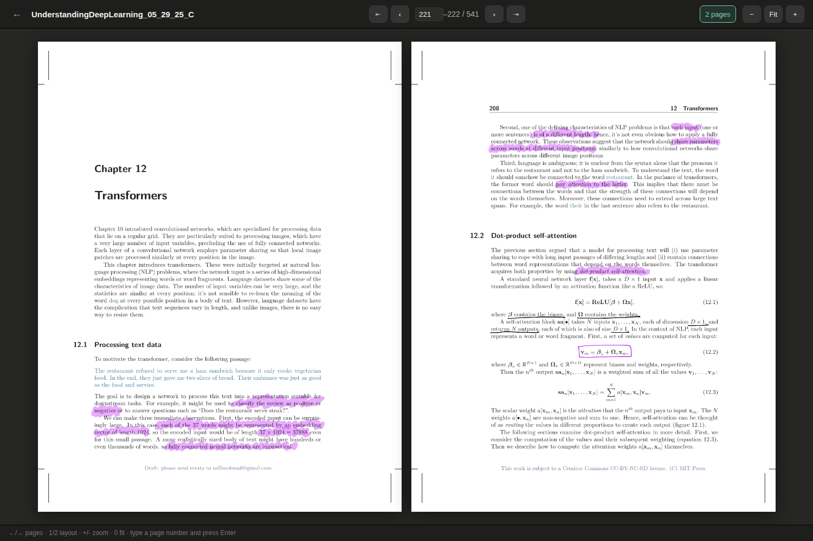
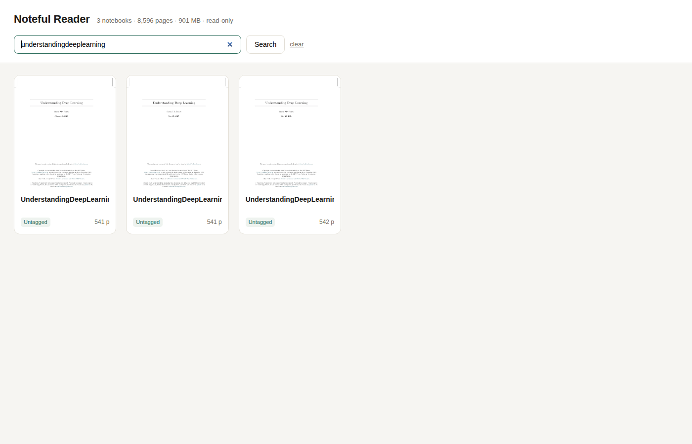
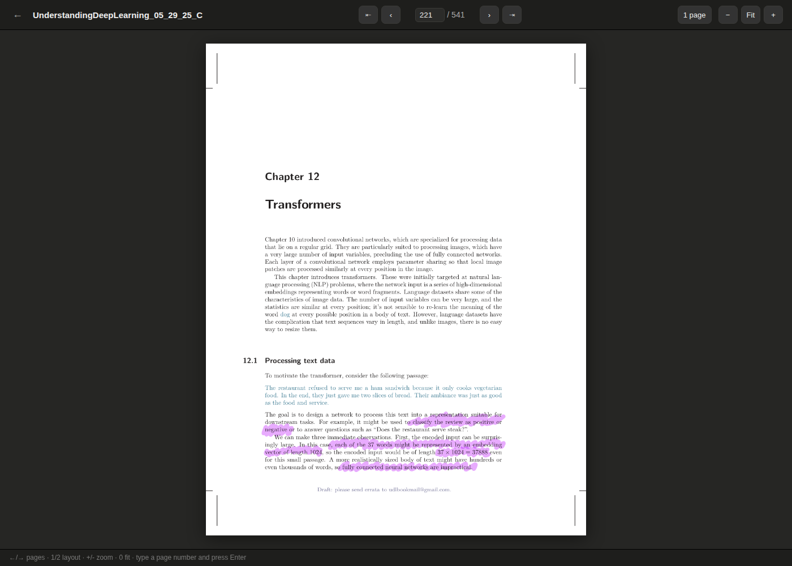

# Noteful Reader

A minimal, **read-only** local web UI for reading `.noteful` notebooks exported
from an iPad on Linux (or any platform with Python). It renders your imported
PDF pages together with Noteful handwriting, highlights, shapes, images and text.

Your backup is opened read-only — the app never writes to it.

**Android:** an installable PWA with Google Drive sync (fully offline, no server)
lives in [`android-pwa/`](android-pwa/README.md).

## Quick start (with uv)

[uv](https://docs.astral.sh/uv/) manages the Python environment and dependencies.
If you don't have it yet:

```bash
curl -LsSf https://astral.sh/uv/install.sh | sh
```

Then, from this folder:

```bash
uv sync                                  # creates .venv and installs Flask + PyMuPDF
export NOTEFUL_BACKUP="/path/to/your/Noteful Backup"
uv run python reader/app.py
```

Open **http://127.0.0.1:8090** in your browser (it opens automatically unless
`--no-browser` is passed).

Even simpler, `run.sh` does the uv setup for you:

```bash
NOTEFUL_BACKUP="/path/to/your/Noteful Backup" ./run.sh
```

If the backup folder has its default name next to the project, you can omit
`NOTEFUL_BACKUP` entirely.

### Without uv

Use any Python 3.10+ environment:

```bash
python3 -m venv .venv
source .venv/bin/activate
pip install "flask>=3.0" "pymupdf>=1.24"
NOTEFUL_BACKUP="/path/to/your/Noteful Backup" python reader/app.py
```

### Configuration

| Setting | Default | Description |
| --- | --- | --- |
| `NOTEFUL_BACKUP` | `./Noteful Backup - <id>` | Folder containing your `.noteful` files (searched recursively) |
| `--port` | `8090` | HTTP port, e.g. `./run.sh --port 9000` |
| `--host` | `127.0.0.1` | Bind address; use `0.0.0.0` to reach it from other devices |
| `--no-browser` | off | Don't open a browser window on startup |

## Features

- **Library** — all notebooks with folder, page count and cover thumbnail, plus a live filter box.
- **Reader** — previous/next page, jump to page, zoom and fit, and keyboard navigation
  (`←`/`→`, `Home`/`End`, `+`/`-`, `0`).
- **One or two pages** — switch with the toolbar button or the `2` key for a side-by-side
  book spread.
- **Deep links** — `?p=221` opens a specific page, `?spread=1` opens in two-page mode.
- **On-demand rendering** — large backups (thousands of pages) open quickly; rendered
  PDF pages are cached in `./cache/`.
- **Read-only by design** — no edit endpoints; only cache files under `./cache/` are written.

## Screenshots — example: Understanding Deep Learning

The examples below use an *Understanding Deep Learning* notebook: the original
book pages are the embedded PDF background, and the pink marks are annotations
made in Noteful.



Library filtered to the UDL notebooks:



A single annotated page (Chapter 12, Transformers):



## How it works

The `.noteful` format is an undocumented big-endian container. This reader uses a
strict parser of its typed-field grammar (adapted from the independent
`noteful-re` reverse-engineering research) to locate:

- note titles, page lists, folders and cover images,
- embedded PDF backgrounds and their page indices,
- handwriting stroke blobs, shapes, images, text boxes and layers.

Each requested page is composed as an SVG: the embedded PDF page is rasterized
with PyMuPDF and drawn underneath the decoded ink and objects, then displayed by
the browser. Pages are rendered lazily, so even an 8,000-page backup starts fast.

## Troubleshooting

- **"Backup folder not found"** — set `NOTEFUL_BACKUP` to the directory that actually
  contains the `.noteful` files.
- **Nothing after starting** — check the terminal for the printed URL, and make sure
  port 8090 is free (`./run.sh --port 9000`).
- **Missing dependency** — run `uv sync` again, or `uv pip install flask pymupdf`.

## Attribution & license

The binary parser and ink/text decoders in `reader/format.py` and
`reader/rich_text.py` are adapted from the MIT-licensed research implementation in
[`Emefedez/noteful-re`](https://github.com/Emefedez/noteful-re), itself an
independent reverse-engineering of the Noteful format. See [LICENSE](LICENSE).

Noteful is a trademark of its respective owner. This project is not affiliated
with or endorsed by Noteful.
